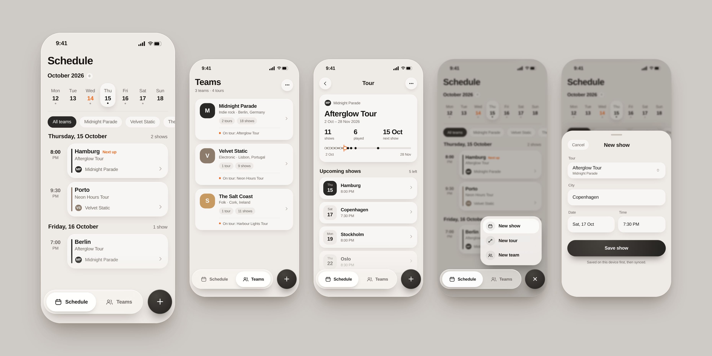
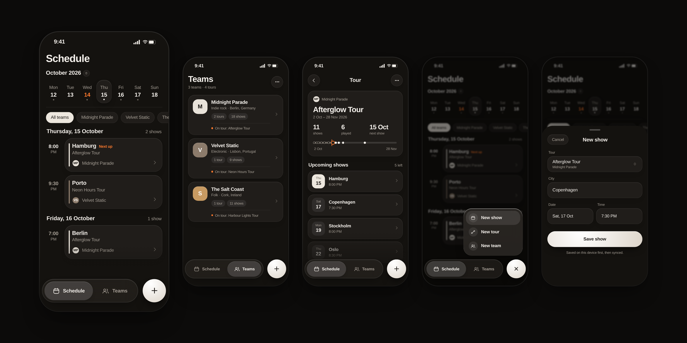

<div align="center">

# TourOps

**Tour management for touring teams, built offline-first.**

Plan teams, tours and shows on the road. Every change is saved on the device first and synchronized when the network allows.

<br>


<br>

<picture>
  <source media="(prefers-color-scheme: dark)" srcset="docs/images/tourops-dark.png">
  
</picture>

</div>

<br>

## Contents

- [Overview](#overview)
- [Interface](#interface)
- [Features](#features)
- [Architecture](#architecture)
- [Synchronization](#synchronization)
- [Testing](#testing)
- [Getting started](#getting-started)
- [Backend contract](#backend-contract)
- [Project structure](#project-structure)
- [Tech stack](#tech-stack)
- [License](#license)

## Overview

TourOps is a tool for the people who run a tour: musicians, bands, artists and tour managers. It is built around one hierarchy:

```
Team  →  Tour  →  Show
```

A team has many tours, and a tour has many shows. The app answers the questions a tour manager asks all day: what is on today, what is next, and where is each team in its tour.

It is also an engineering project about offline-first mobile software: durable local writes, an operation queue, optimistic concurrency, retry and failure handling, and reconciling local state with a remote source of truth. The domain is deliberately small so the focus stays on those problems.

## Interface

The interface follows the system appearance and ships in light and dark. Cards carry a soft shadow in light mode and a hairline border in dark mode. The primary action is ink in light mode and cream in dark mode.

| Screen | What it shows |
| --- | --- |
| **Schedule** | The home screen. A week strip with a marker for today and dots on days that have shows, team filter chips, and a time-ruled agenda of show cards with a team-colored bar and a "Next up" label. |
| **Teams** | One card per team with a monogram, genre and location, tour and show counts, and an "On tour" status line. |
| **Tour** | A summary of shows, shows played and the next show, a tour timeline, and the list of upcoming shows. |
| **Create** | A floating capsule navigation with a separate add button. The add button opens a menu to create a show, a tour or a team. |
| **Forms** | Team, tour and show forms are bottom sheets with Cancel, a title and a Save action that states where the data goes first. |

### Light


### Dark



## Features

- **Schedule-first navigation.** Schedule and Teams are the two tabs; Schedule opens first.
- **Team → Tour → Show management.** Create, read, update and delete at every level, with navigation across the hierarchy.
- **Offline-first persistence.** Every mutation is written to SwiftData before anything is sent.
- **Durable sync queue.** An entity change and its `SyncOperation` are committed in a single `ModelContext.save()`.
- **Push and pull sync.** Version-checked writes over Supabase's REST interface, and status-aware reconciliation on pull.
- **Sync status.** A compact pill appears only while changes are waiting to sync, so it never occupies the interface otherwise.
- **Optimistic concurrency.** Local edits based on an outdated version are rejected, and the server enforces the same rule.
- **Authentication.** Email and password sign-in through Supabase Auth.
- **Accessibility.** Dynamic Type, VoiceOver labels, adaptive layouts for large text sizes, and previews in both appearances.

## Architecture

MVVM with a repository layer. Domain models are plain structs, and SwiftData entities never leave the data layer: they are converted through explicit mappers and DTOs.

```
SwiftUI View
     ↓
ViewModel            (@Observable, @MainActor)
     ↓
Repository protocol
     ↓
SyncTracking repository ──► SwiftData repository ──► SwiftData
        │
        └──► SyncOperation queue ──► SyncScheduler ──► SyncEngine ──► SyncService ──► Supabase REST
```

| Layer | Responsibility | Examples |
| --- | --- | --- |
| Domain/Model | Framework-agnostic value types | `Team`, `Tour`, `Show`, `SyncOperation` |
| Domain/Repositories | Repository contracts and errors | `ShowRepositoryProtocol`, `RepositoryError` |
| Domain/Sync | Sync policy and state machine | `SyncEngine`, `SyncOperationReducer`, `SyncRetryPolicy`, `SyncScheduler` |
| Domain/Network | Network contracts and error types | `APIClientProtocol`, `APIClientError` |
| Domain/Authentication | Auth state and the token provider seam | `AuthState`, `SyncAuthProviding` |
| Data/Persistence | SwiftData `@Model` entities | `TeamEntity`, `SyncOperationEntity` |
| Data/DTO, Data/Mappers | Wire types and Domain ⇄ DTO mapping | `ShowDTO`, `ShowMapper` |
| Data/Repositories | SwiftData repositories, sync-tracking decorators, reconcilers | `SwiftDataShowRepository`, `SyncTrackingShowRepository`, `ShowReconciler` |
| Data/Supabase, Data/Networking, Data/Sync | Supabase auth, REST push and pull, request building, pull coordinators | `SupabaseSyncService`, `SupabaseShowPullService`, `SyncRequestBuilder`, `ShowPullCoordinator` |
| DesignSystem | Adaptive light and dark tokens, shared components | `Palette`, `FloatingNavBar`, `FormSheet`, `TeamAvatar` |
| Features/* | One View and ViewModel per screen | `ScheduleView`, `TeamListView`, `TourDetailView` |

### Design notes

- **Dependency injection** is plain initializer injection. The composition root in `TourOpsApp.init` wires everything by hand, and `AppShell` hosts the two tabs.
- **Adaptive design system.** Colors are defined once as light and dark pairs and resolve from the system appearance. Screens never branch on the color scheme for color; only shadows versus borders differ.
- **Derived presentation data.** The Schedule agenda, team overviews and tour timeline are pure functions over existing models, so they are unit-tested without UI or persistence. A team's tint is derived from its id, so nothing extra is stored.
- **Where the protocol boundary stops.** Repository protocols expose only fetch, create, update and delete. The `stage*` methods (mutate the context without saving) and the remote-apply methods exist only on the concrete `SwiftData*Repository` types, because the sync-tracking decorators and the reconcilers combine several changes under one save. The engine, scheduler, sync service, API client and auth provider sit behind protocols.
- **Concurrency.** The app target builds in Swift 5 language mode with default MainActor isolation and approachable concurrency enabled. Repositories, the engine, the scheduler and the reconcilers share the main `ModelContext`.
- **View refresh.** Views reload through `.task(id:)` keyed on a `DataRefreshSignal` generation counter, which the app bumps after a pull succeeds or a sheet is dismissed.

## Synchronization

### Write path: one save, two records

```
ViewModel → SyncTracking repository
              1. stage the entity change          (no save)
              2. encode the DTO payload
              3. stage the SyncOperation          (no save)
              4. modelContext.save()              (single commit)
              5. syncScheduler.scheduleSync()
```

Staging both records and saving once means a committed local change always has a matching operation. No suspension point sits between staging and the save, and everything runs on the main actor against one context.

An operation records two version numbers. `operation.version` is the version the server is expected to hold (the base), and the payload carries the post-update version (`base + 1`).

### Push: SyncEngine

1. Fetch pending operations. Operations stuck in `.processing` from an interrupted run are reset to `.pending` first.
2. Group by entity, and order groups team, then tour, then show, then by creation time.
3. Reduce each group (see below). Superseded operations are deleted before the remaining one is sent.
4. Mark the operation `.processing`, execute it through `SyncServiceProtocol`, and delete it on success.
5. If a sync is requested while one is running, the engine records the request and runs again when the current pass ends.

`SyncScheduler` coalesces triggers. `scheduleSync()` is fire-and-forget, and `syncNow()` awaits the running or a new sync.

### Operation reduction

| Sequence for one entity | Result |
| --- | --- |
| create, then update(s) | one create with the latest payload and the original version |
| create, then delete | both dropped; nothing is sent |
| update, then update | one update with the original base version and the latest payload |
| update, then delete | the delete |

### Failure handling

| Outcome | Result |
| --- | --- |
| `SyncError.conflict` (HTTP 409 on update or delete, or an empty representation) | `.conflict`, no retry |
| `APIClientError.networkError` | back to `.pending`, retry count unchanged |
| Non-retryable `APIClientError` (decoding failure, 4xx) | `.failed` |
| Any other error, including 5xx | retry count + 1; `.pending` while the count is below the limit (3), otherwise `.failed` |
| Cancellation | back to `.pending` |

Only `.pending` operations are fetched for sending, so `.conflict` and `.failed` operations are not retried automatically. A failed attempt is retried at the next trigger.

### Concurrency control against the server

Updates and deletes are sent as PostgREST requests filtered on the expected version:

```
PATCH  /rest/v1/shows?id=eq.<id>&version=eq.<base>
DELETE /rest/v1/shows?id=eq.<id>&version=eq.<base>
```

The request asks for `Prefer: return=representation`. If the filter matches no row, the response is an empty array and the client treats it as a conflict. Creates carry no filter. An empty result can mean a version mismatch, a row deleted elsewhere, or a row the user is not allowed to see; the client does not distinguish between them.

### Idempotency of creates

Entity IDs are generated on the client and used as primary keys. If a create is replayed, the duplicate is rejected by the server, and an HTTP 409 on a create is treated as success.

### Pull and reconciliation

After pushing, the app fetches all teams, tours and shows and reconciles each set against local data:

| Situation | Rule |
| --- | --- |
| Remote entity missing locally | Create it locally, unless a pending or processing delete exists for it |
| Local entity has a pending, processing or conflicted operation | Keep the local version |
| Local entity has no blocking operation (failed operations do not block) | Apply the remote version only if `remote.version > local.version` |
| Local entity missing from the remote result | Delete it locally only if it has no operations of any status |
| Remote result is empty while local data exists | Never treated as "delete everything" |

Each entity type is pulled independently; a failure in one is logged and does not stop the others.

### Triggers

- `scheduleSync()` after every local mutation.
- Push, then pull, when the user signs in and whenever the app becomes active.

### Behavior worth knowing

- Conflicted and failed operations are kept for inspection and are not retried automatically.
- Because failed operations do not protect an entity during reconciliation, a newer remote version replaces a local edit whose operation has failed.
- Only creates are idempotent. A create that the server rejects with 409 for any reason is treated as already applied.
- Each pull fetches whole tables and infers remote deletions from absence; only an empty response is guarded against.
- Deleting a team removes only the team locally; its tours and shows are filtered out in the views by parent ID.

## Testing

Unit tests use Swift Testing and cover:

- **SyncEngine:** success, retry, retry limit, conflict, cancellation, lost wake-up, reduction integration, entity ordering.
- **SyncOperationReducer** and **SyncRetryPolicy**.
- **SyncScheduler:** coalescing, `syncNow()`, cancellation.
- **SupabaseSyncService** and **SyncEndpoint:** version-filtered URLs, empty-result and 409 handling, create idempotency.
- The Show and Team pull services, the Tour and Show pull coordinators, and the Team, Tour and Show reconcilers, including the full operation-status matrix.
- SwiftData repositories and the sync-tracking repositories, against an in-memory `ModelContainer`.
- **APIClient** through a `URLProtocol` stub, JSON date decoding, and the list ViewModels.
- **Schedule derivations:** agenda grouping, week strip, next-up selection, default tour, team overview, tour timeline and load-state resolution.

Network, auth and the sync service are mocked in the engine and service tests. Repository, tracking and reconciler tests use a real in-memory SwiftData store instead of mocking SwiftData.

Run the suite with **Cmd+U** in Xcode.

## Getting started

**Requirements:** Xcode with the iOS 26 SDK (deployment target is iOS 26.0) and a Supabase project.

1. Open `TourOps.xcodeproj`. Swift Package Manager resolves `supabase-swift`.
2. Point the app at your Supabase project by setting `SUPABASE_URL` and `SUPABASE_PUBLISHABLE_KEY` in the TourOps target's build settings. They are injected into `Info.plist` and read at launch; the app stops with an error if either is missing.
3. Create the tables described in the [backend contract](#backend-contract) and enable row level security.
4. Create a user in Supabase Auth, build and run the **TourOps** scheme on an iOS 26 simulator or device, and sign in.

## Backend contract

The schema is not included in this repository. The client expects three tables — `teams`, `tours` and `shows` — reachable through Supabase's REST interface, with these columns:

| Table | Columns |
| --- | --- |
| `teams` | `id` (uuid), `name`, `genre`, `country`, `city`, `created_at`, `version` (integer), `user_id` |
| `tours` | `id` (uuid), `team_id`, `name`, `start_date`, `end_date`, `created_at`, `version` (integer), `user_id` |
| `shows` | `id` (uuid), `tour_id`, `name`, `venue`, `city`, `date`, `created_at`, `version` (integer), `user_id` |

- The client sets `user_id` from the signed-in session on create operations only.
- Dates are ISO 8601; decoding accepts timestamps with or without fractional seconds.
- On update, the client sends the post-update version in the payload and filters on the previous version. Whether the server also owns or increments `version` (for example with a trigger) is a backend concern.
- Access control depends entirely on the row level security policies you configure.

## Project structure

```
TourOps/
├── App/            TourOpsApp (composition root), AppShell (tabs, floating nav, create flow), DataRefreshSignal
├── DesignSystem/   Palette, typography, card surface, floating navigation, form components, team identity, state panels
├── Domain/
│   ├── Authentication/   AuthState, SyncAuthProviding
│   ├── Model/            Team, Tour, Show, ShowStatus, SyncOperation
│   ├── Network/          APIClient and its protocol and errors
│   ├── Repositories/     Repository protocols, RepositoryError
│   └── Sync/             SyncEngine, reducer, retry policy, scheduler, service protocols
├── Data/
│   ├── Authentication/   AuthSessionController
│   ├── DTO/              Codable wire types
│   ├── Mappers/          Domain ⇄ DTO
│   ├── Networking/       Endpoint, SyncEndpoint, SyncRequestBuilder, JSONCoding
│   ├── Persistence/      SwiftData entities
│   ├── Repositories/     SwiftData, sync-tracking and mock repositories, reconcilers
│   ├── Supabase/         Client, auth, push and pull services
│   └── Sync/             DefaultSyncService, pull coordinators
└── Features/       Authentication, Schedule, Teams, Tours, Show

TourOpsTests/       Swift Testing unit tests (Network, Repositories, Sync, ViewModels, Features)
docs/images/        Interface images used in this README
```

## Tech stack

| Category | Technology |
| --- | --- |
| Language | Swift 5 language mode, default MainActor isolation |
| UI | SwiftUI, NavigationStack, adaptive light and dark design system |
| State | Observation (`@Observable`) |
| Concurrency | async/await, structured and unstructured Task |
| Local persistence | SwiftData |
| Networking | URLSession through a small APIClient |
| Backend | Supabase: PostgreSQL, Auth, PostgREST |
| Dependencies | supabase-swift (authentication) |
| Testing | Swift Testing |

## License

MIT. See [LICENSE](LICENSE).
